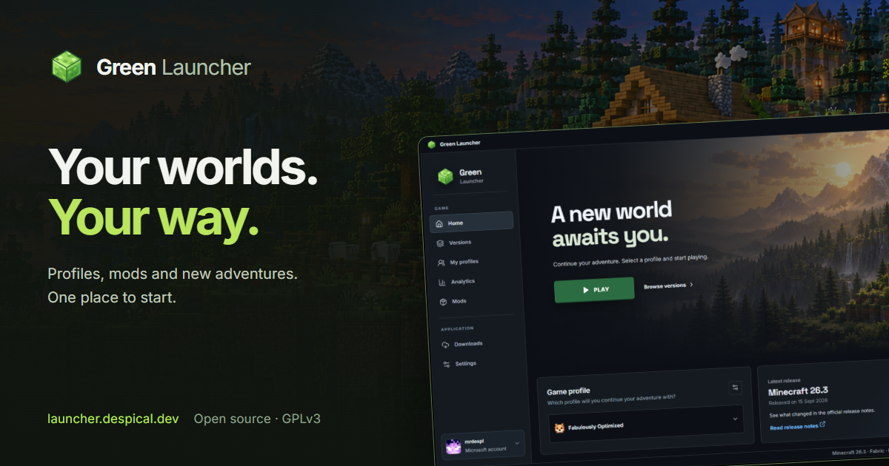

# Green Launcher Website

[](https://github.com/Despical/GreenLauncherWebsite/actions/workflows/build.yml)
[](LICENSE)
[](https://adoptium.net/)

The official website for [Green Launcher](https://github.com/Despical/GreenLauncher):
features, downloads, release notes and an administrator-only publishing panel.

**[Visit the website](https://launcher.despical.dev)** ·
[Features](https://launcher.despical.dev/features) ·
[Changelog](https://launcher.despical.dev/changelog) ·
[FAQ](https://launcher.despical.dev/faq) ·
[Discord](https://discord.gg/uXVU8jmtpU)

## Features

- A Minecraft landscape, real launcher screenshots and animated image previews.
- Turkish, English, German, French, Russian and Polish visitor interfaces.
- Searchable release history, Windows setup and portable downloads, checksums and HTTP Range support.
- Accessible FAQ accordions, keyboard controls and reduced-motion support.
- Draft editing, uploads, publication and import of new stable releases from the official launcher repository.
- BCrypt authentication, CSRF protection, CSP, secure production cookies and login rate limiting.
- Persistent H2 for local development; PostgreSQL and a non-root Docker image for production.

The application uses **Java 25**, **Spring Boot**, **Thymeleaf**, JDBC and Flyway.
CSS and JavaScript are served directly; Node.js and a frontend development server are not required.

## Run locally

Install JDK 25 and set `JAVA_HOME`, then clone and start the application:

```sh
git clone https://github.com/Despical/GreenLauncherWebsite.git
cd GreenLauncherWebsite
./gradlew bootRun
```

On Windows, use `gradlew.bat bootRun`, `start.bat` or `./start.ps1`.

- Website: `http://localhost:8087`
- Administration: `http://localhost:8087/admin`
- Default local username: `admin`
- Generated local password: `data/local-admin-password.txt`

The local profile binds to loopback. Its database, password file and uploads stay under
`data/`, which is excluded from Git and Docker builds. Production never generates a password.

## Docker

Copy `.env.example` to `.env`, choose a strong database password and set
`SITE_ADMIN_PASSWORD_HASH` to a BCrypt hash of your administrator password.
Keep the hash single-quoted in `.env` so Compose preserves its dollar signs.
Use a trusted local BCrypt tool; never commit the password or hash.

```sh
cp .env.example .env
# Edit .env before starting.
docker compose up -d --build
docker compose ps
```

Compose runs PostgreSQL 17 and the application, with separate persistent volumes for
its database and uploaded releases. Port 8087 binds to `127.0.0.1`.
Serve the application through an HTTPS reverse proxy; production administrator cookies require HTTPS.

`SITE_PUBLIC_URL` controls canonical and social preview URLs. Other configuration keys are
`SITE_ADMIN_USERNAME`, `SITE_STORAGE`, `PORT`, `DB_URL`, `DB_USERNAME` and `DB_PASSWORD`.
Spring does not load `.env` by itself; Compose supplies these environment variables.

Keep deployment-specific network overrides outside Git. The public Compose file works
independently; adapt your own reverse proxy and TLS configuration to your hosting environment.
Back up both named volumes and avoid `docker compose down -v` when preserving installation data.

### Analytics

Optionally set `GOOGLE_ANALYTICS_ID` to a GA4 measurement ID (`G-...`). The integration is
enabled only on public HTTPS pages at the configured site origin. It never runs in the
administrator panel or local development. Google tags load after the visitor accepts
analytics cookies; the footer's cookie settings allow the choice to be changed later.
Advertising storage and personalization stay disabled, and page URLs omit query strings.

## Release management

An empty installation imports the bundled snapshot of public Green Launcher releases.
Imported downloads redirect to the corresponding official GitHub asset. The administrator's
GitHub sync action adds new stable releases without overwriting existing notes or drafts.

To publish files through this website:

1. Create a draft with a unique version such as `0.20.0`.
2. Add a title, summary and notes. Notes support plain text, headings and lists; HTML stays inert.
3. Upload `GreenLauncher-Setup-0.20.0.exe`, its `.exe.blockmap`, and `GreenLauncher-0.20.0.exe`.
4. Optionally upload `GreenLauncher-0.20.0.exe.blocks.json` for portable differential updates.
5. Publish. The application generates `latest.yml`, `portable-update.json` and `SHA256SUMS.txt`.

Files are limited to 1 GB, checked for version-specific names and hashed while streaming.
Published files cannot be replaced; unpublishing hides their downloads immediately.
EXE header checks do not replace testing or signing the launcher package.

Update endpoints are `/updates/latest.yml`, `/updates/portable-update.json` and
`/updates/{version}/{filename}`. Semantic version ordering prevents older releases from
replacing the current release. The desktop launcher's existing GitHub update provider is
configured in the launcher repository; deploying this website does not change it.

## Source layout

```text
src/main/java/dev/despical/greenweb/
  config/       Authentication, locale resolution and MVC configuration
  release/      Metadata, persistence, file storage and GitHub import
  web/          Public pages, downloads, administration and view metadata
src/main/resources/
  db/migration/ Flyway schema migrations
  releases/     Public release metadata snapshot
  templates/    Thymeleaf pages and shared fragments
  static/       Styles, scripts, fonts, screenshots and optimized artwork
  messages*.properties
src/test/java/  Isolated application integration tests
deploy/nginx/   Production reverse proxy configuration
```

Local authoring documents, screenshot capture helpers and QA scripts are not runtime dependencies
and are excluded from this repository. Only the optimized world artwork is packaged.

## Build and contribute

```sh
./gradlew clean test bootJar
```

Integration tests use an isolated H2 database and temporary file storage. They cover public pages
in six languages, locale selection, authentication and CSRF, draft visibility, release uploads,
checksums, HTTP Range requests and public metadata. CI also builds the Docker image.

See [CONTRIBUTING.md](CONTRIBUTING.md), [CODE_OF_CONDUCT.md](CODE_OF_CONDUCT.md) and
[SECURITY.md](SECURITY.md). Report launcher application problems in the
[launcher repository](https://github.com/Despical/GreenLauncher/issues).

## License

Copyright © 2026 Berke Akçen (Despical). Licensed under
the [GNU General Public License v3.0 or later](LICENSE).

Bundled fonts, icons and third-party marks retain their respective licenses and rights;
see [THIRD_PARTY_NOTICES.md](THIRD_PARTY_NOTICES.md).
Green Launcher is not affiliated with Mojang or Microsoft.
